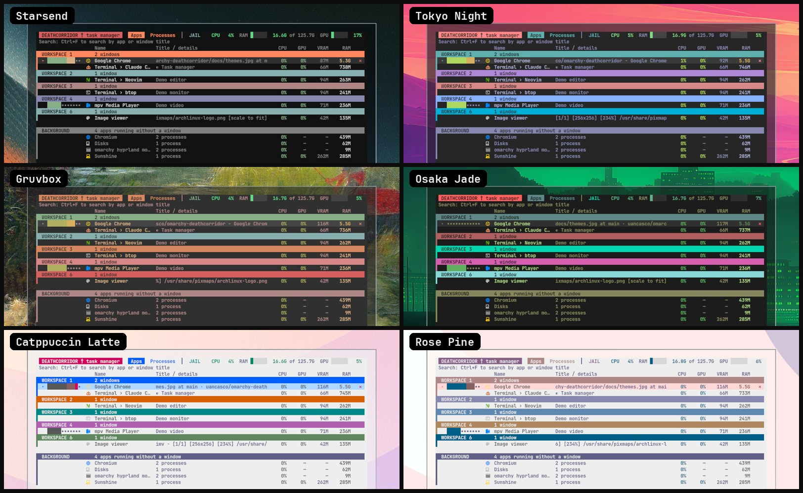

# deathcorridor — a task manager for Omarchy


**Managing processes on Linux shouldn't need a manual.** deathcorridor is the Ctrl+Alt+Del that new Linux users are missing: one key opens it, you see your apps in plain language, and when something hangs or keeps crashing you press Enter and an AI explains what is wrong, asks "ok?", fixes it and puts everything back. No `kill -9`, no `htop`, no forum threads.

- **Made for people who don't know the terminal:** apps grouped by workspace, one-key *end task*, protection against ending something critical by accident, and a calm JAIL view that only speaks up when something really needs attention.
- **Looks like your desktop:** it reads the active Omarchy theme and follows it, so it matches your colors, whatever theme you use (it picks up a new theme the next time you open it).
- **Bring your own AI:** Claude, Codex, Gemini, OpenCode, or any command you configure (a local model, your own script). Nothing leaves your machine unless you pick a remote one.
- **Still fast for experts:** sort, group by name, search, GPU/VRAM per process, a live audio meter per app.

It is a terminal app (floating window) with three places:

- **Apps** — your windows by workspace, plus apps running in the background, with live CPU / GPU / VRAM / RAM and an audio meter.
- **Processes** — every process of yours, sortable, grouped by name, with a *Load* column that puts the thing that matters first.
- **JAIL** (`F2`) — what needs attention: an app not responding, or one that keeps crashing. `Enter` hands the case (crash backtrace, journal, kernel warnings, recent updates, with your user/host/paths redacted) to an AI of your choice, which explains it in plain language, asks `ok?`, fixes it and puts everything back.

**Follow a program** (`w`): flag any app with `w` (it gets a `◉`). deathcorridor records when it starts, exits, crashes, hangs, hogs a CPU core or grows in memory, and keeps CPU/RAM samples. Fix it sends the AI the whole timeline; afterwards it checks the app stays healthy for 10 minutes and tells you when it is fixed (desktop notification), or brings it back if it fails again.


### It follows your theme

Six Omarchy themes, dark and light, same screen, with apps open on five workspaces. The colors are not hard-coded to one look:

- every color is checked for contrast against the theme's background, so light themes stay readable;
- the accent and the workspace colors are picked from the theme's palette by how much of your **wallpaper** each one covers;
- the background takes a faint tint (about 13%) of the wallpaper's dominant color. Set `DEATHCORRIDOR_TINT=0` to turn that off.

(Reading the wallpaper needs Pillow or ImageMagick; without them it falls back to the theme alone.)



## Install

```
omarchy plugin add https://github.com/uancasco/omarchy-deathcorridor --enable
```

This adds a task-manager button to the bar. The app itself lives in `bin/`; the button runs `bin/deathcorridor-open`, which opens it or raises it if it is already open (floating, pinned, on top).

**Keyboard shortcut:** the first time you open it, deathcorridor asks if you want a shortcut (`Ctrl + Alt + Delete`, `Super + Ctrl + M`, or one you type). If you accept, it adds one clearly marked block to `~/.config/hypr/bindings.lua`, after saving a backup in `~/.local/state/deathcorridor/backups/`, and warns you before replacing a shortcut that already does something (for example Omarchy's "Close all windows" on `Ctrl + Alt + Delete`). Nothing is changed unless you pick one. Press `k` inside the app to change or remove it later; removing it deletes only that block.

If you prefer to do it by hand, add this to `bindings.lua`:

```lua
o.bind("SUPER + CTRL + M", "Task manager", "~/.config/omarchy/plugins/io.github.uancasco.deathcorridor/bin/deathcorridor-open", { dont_inhibit = true })
```

Optional, so it reads over anything: in `hyprland.lua`

```lua
o.window("^TUI.float$", { tag = "-default-opacity", opacity = "1 override 1 override 1 override", opaque = true })
```

## Other distros and desktops

The **bar button and the marketplace listing are Omarchy-only** (they are a Quickshell plugin). The app itself is one Python 3 script with no pip dependencies, so you can run it anywhere: `python3 bin/deathcorridor`.

| | Omarchy (Hyprland) | Other Linux |
|---|---|---|
| Processes view, sorting, search, end task, follow (`w`) | yes | yes (Linux `/proc`) |
| JAIL: hung apps, repeated crashes, AI fix | yes | yes with systemd (`coredumpctl`, `journalctl`) |
| Apps view with windows and workspaces | yes | no: needs Hyprland (`hyprctl`); without it the app opens on Processes and Apps only lists background apps |
| Audio meter per app | yes | yes with PipeWire/PulseAudio (`pactl`, `parec`) |
| GPU / VRAM columns | NVIDIA (`nvidia-smi`) | NVIDIA only; AMD and Intel show blanks |
| Theme colors and wallpaper accent | Omarchy theme | built-in colors (Python 3.11+ is also needed to read themes) |
| Package and "recent updates" in the case file | pacman | package name via pacman, dpkg or rpm (untested outside Arch); update history is pacman-only |
| Keyboard shortcut offer | yes | not offered (it edits Omarchy's `bindings.lua`) |
| AI window | Omarchy's launcher | first terminal found, or the case is copied to the clipboard (`wl-copy`, `xclip`, `xsel`) |

Tested on Omarchy only. Reports and patches for other setups are welcome.

## Keys

| Key | Action |
|---|---|
| `↑ ↓` / click | pick a row |
| `Tab` | Apps ⇄ Processes |
| `F2` | JAIL |
| `Ctrl+F` or `/` | search (Enter or arrows leave the search, Esc clears it) |
| `x` / `Del` | end the picked task (asks twice for critical ones) |
| `c` | close the picked window (Apps) |
| `w` | follow / stop following the picked program |
| `k` | set, change or remove the keyboard shortcut |
| `a` / `Enter` in JAIL | Fix it: send the case to your AI |
| `i` in JAIL | choose the AI |
| `← →`, `Ctrl+R`, `Ctrl+G` | Processes: sort column, reverse, group by name |
| `Esc` | clear search, leave JAIL, quit |

## The AI

On first entering JAIL it asks which AI to use (only if several are installed): `claude`, `codex`, `gemini` or `opencode`. Any other AI, script or local model runner works through a custom command in `ai.conf` (for example `command = my-ai --prompt "$(cat {file})"`). If none is installed, Fix it copies the case to the clipboard so you can paste it anywhere. Config: `~/.config/deathcorridor/ai.conf` (also lets you set your own command). claude is started with a read-only allowlist, so the only question is the `ok?` before a real change.

## What it reads and writes

- Reads: `/proc`, `ps`, `hyprctl`, `coredumpctl`, `journalctl`, `pacman -Q`, `nvidia-smi` (if present), `pactl`/`parec` (audio meter).
- Sends nothing anywhere by itself. A case file only leaves your machine if you choose an AI that is remote.
- Writes only under `~/.local/state/deathcorridor/` (reports, `watched.json`, `watch/`, `actions.log`, `crash.log`) and `~/.config/deathcorridor/ai.conf`. The only file outside those is your `~/.config/hypr/bindings.lua`, and only if you choose a shortcut (one marked block, with a backup). Those folders are created owner-only (`0700`, files `0600`) whatever your umask is, and older files are tightened on start, because they hold paths and the history of programs you follow.
- It can end processes of your user (SIGTERM, then SIGKILL). It never touches itself or the terminal that hosts it.

Remove: `omarchy plugin remove`, then optionally delete the two folders above.

## Requirements

Omarchy (Hyprland, Quickshell shell) for the plugin, Python 3 (standard library only; 3.11+ for theme colors). Optional, each one only enables its part: `jq` and `hyprctl` (Apps view, opener), `notify-send`, `wl-copy`/`xclip`/`xsel`, `nvidia-smi`, `pactl` + `parec`, `coredumpctl`/`journalctl`, ImageMagick or Pillow (wallpaper accent).

## License

MIT
