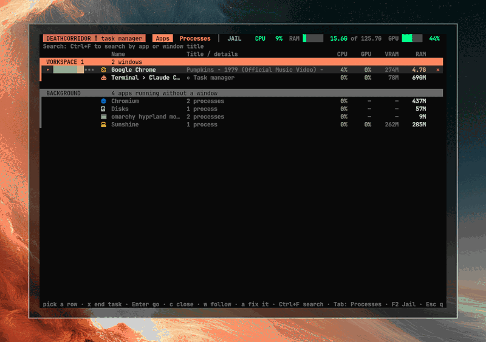
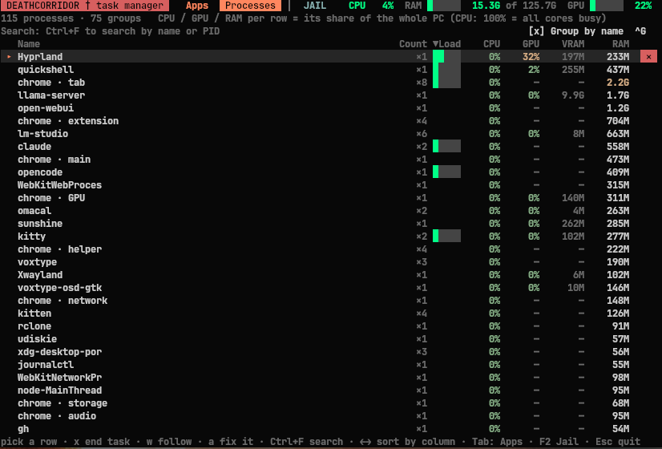
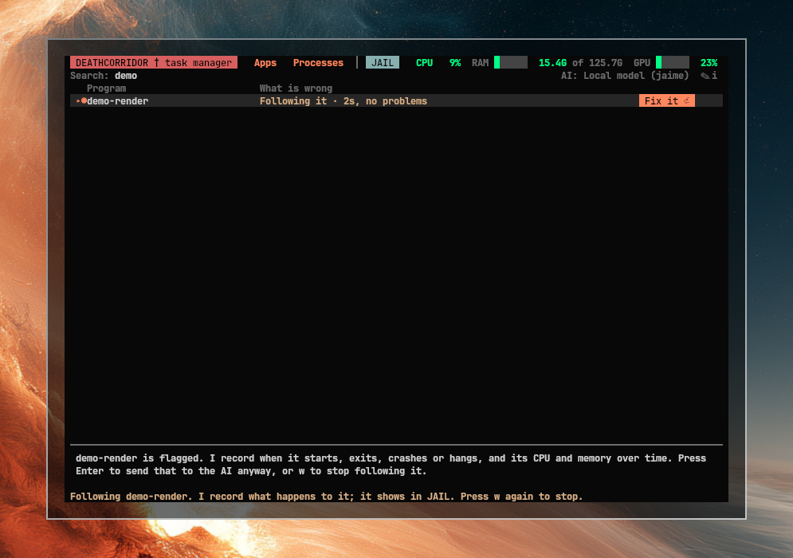

# deathcorridor — a task manager for Omarchy



**Managing processes on Linux shouldn't need a manual.** deathcorridor is the Ctrl+Alt+Del that new Linux users are missing: one key opens it, you see your apps in plain language, and when something hangs or keeps crashing you press Enter and an AI explains what is wrong, asks "ok?", fixes it and puts everything back. No `kill -9`, no `htop`, no forum threads.

- **Made for people who don't know the terminal:** apps grouped by workspace, one-key *end task*, protection against ending something critical by accident, and a calm JAIL view that only speaks up when something really needs attention.
- **Looks like your desktop:** it reads the active Omarchy theme and follows it, so it matches your colors, whatever theme you use (it picks up a new theme the next time you open it).
- **Bring your own AI:** Claude, Codex, Gemini, OpenCode or a local model. Nothing leaves your machine unless you pick a remote one.
- **Still fast for experts:** sort, group by name, search, GPU/VRAM per process, a live audio meter per app.

It is a terminal app (floating window) with three places:

- **Apps** — your windows by workspace, plus apps running in the background, with live CPU / GPU / VRAM / RAM and an audio meter.
- **Processes** — every process of yours, sortable, grouped by name, with a *Load* column that puts the thing that matters first.
- **JAIL** (`F2`) — what needs attention: an app not responding, or one that keeps crashing. `Enter` hands the case (crash backtrace, journal, kernel warnings, recent updates, with your user/host/paths redacted) to an AI of your choice, which explains it in plain language, asks `ok?`, fixes it and puts everything back.

**Follow a program** (`w`): flag any app with `w` (it gets a `◉`). deathcorridor records when it starts, exits, crashes, hangs, hogs a CPU core or grows in memory, and keeps CPU/RAM samples. Fix it sends the AI the whole timeline; afterwards it checks the app stays healthy for 10 minutes and tells you when it is fixed (desktop notification), or brings it back if it fails again.





## Install

```
omarchy plugin add https://github.com/uancasco/omarchy-deathcorridor --enable
```

This adds a task-manager button to the bar. The app itself lives in `bin/`; the button runs `bin/deathcorridor-open`, which opens it or raises it if it is already open (floating, pinned, on top).

Bind it to a key in `~/.config/hypr/bindings.lua` (Omarchy's Lua config):

```lua
o.bind("SUPER + CTRL + M", "Task manager", "~/.config/omarchy/plugins/io.github.uancasco.deathcorridor/bin/deathcorridor-open", { dont_inhibit = true })
```

Optional, so it reads over anything: in `hyprland.lua`

```lua
o.window("^TUI.float$", { tag = "-default-opacity", opacity = "1 override 1 override 1 override", opaque = true })
```

## Keys

| Key | Action |
|---|---|
| `↑ ↓` / click | pick a row |
| `Tab` | Apps ⇄ Processes |
| `F2` | JAIL |
| `Ctrl+F` or `/` | search (Enter or arrows leave the search, Esc clears it) |
| `x` / `Del` | end the picked task (asks twice for critical ones) |
| `c` | close the picked window (Apps) |
| `w` | follow / stop following the picked program |
| `a` / `Enter` in JAIL | Fix it: send the case to your AI |
| `i` in JAIL | choose the AI |
| `← →`, `Ctrl+R`, `Ctrl+G` | Processes: sort column, reverse, group by name |
| `Esc` | clear search, leave JAIL, quit |

## The AI

On first entering JAIL it asks which AI to use (only if several are installed): `claude`, `codex`, `gemini`, `opencode`, or a local model through a `jaime` command. If none is installed, Fix it copies the case to the clipboard so you can paste it anywhere. Config: `~/.config/deathcorridor/ai.conf` (also lets you set your own command). claude is started with a read-only allowlist, so the only question is the `ok?` before a real change.

## What it reads and writes

- Reads: `/proc`, `ps`, `hyprctl`, `coredumpctl`, `journalctl`, `pacman -Q`, `nvidia-smi` (if present), `pactl`/`parec` (audio meter).
- Sends nothing anywhere by itself. A case file only leaves your machine if you choose an AI that is remote.
- Writes only under `~/.local/state/deathcorridor/` (reports, `watched.json`, `watch/`, `actions.log`, `crash.log`) and `~/.config/deathcorridor/ai.conf`.
- It can end processes of your user (SIGTERM, then SIGKILL). It never touches itself or the terminal that hosts it.

Remove: `omarchy plugin remove`, then optionally delete the two folders above.

## Requirements

Omarchy (Hyprland, Quickshell shell), Python 3 (standard library only), `jq`, `hyprctl`, `notify-send`, `wl-copy`. Optional: `nvidia-smi`, `pactl` + `parec`, `coredumpctl`.

## License

MIT
